[English](README.md) | [中文](README.zh-CN.md) | **Русский (полный перевод)**

<h1 align="center">Пользовательские приложения MGU</h1>

<p align="center">
  <b>Приложения для головного устройства BMW MGU (iDrive 7), которые рисует собственный GPU-движок с настоящими 60 fps.</b><br>
  В комплект также входит всё необходимое для создания собственных приложений.
</p>

<p align="center">
  
  
  
  
</p>

<p align="center">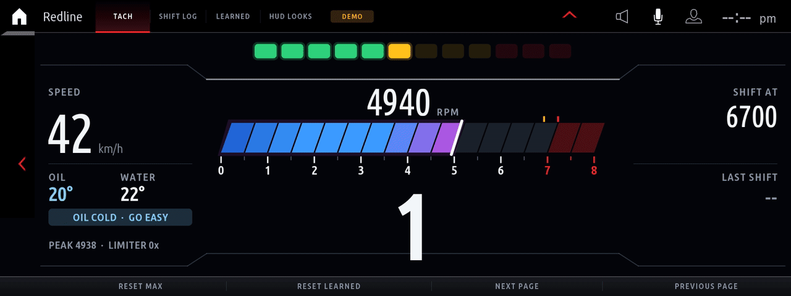</p>

Реальный запас хода на электротяге, состояние батареи и журнал зарядок для подключаемых гибридов, текущая мощность батареи, температуры ячеек и энергопотребление климата. Спортивная панель с наддувом, давлением топлива, опережением зажигания, пропусками зажигания и данными шин. Индикаторы переключения и полноэкранный тахометр, виртуальный диностенд, тесты торможения и разгона, измеритель перегрузок, помощник прогрева масла, сканер и очистка ошибок, сервисные интервалы автомобиля и Doom для стоянки. Приложения работают на штатной платформе, используют настоящие кнопки и меню HMI, читают данные автомобиля и сохраняются после перезагрузки. Всё можно удалить одной командой.

> **Отказ от ответственности.** Это неофициальный любительский проект, не связанный с BMW AG и не одобренный ею. Вы изменяете головное устройство на свой риск. Используйте приложения на стоянке или закрытом треке и следите за дорогой. Сканер ошибок может очищать память ошибок во всех блоках автомобиля — сначала прочитайте коды.

---

<a id="not-a-png-slideshow-a-custom-render-engine"></a>
## Не слайд-шоу из PNG: собственный графический движок

В платформе BMW приложение может показать собственную графику только одним способом: нарисовать изображение в JavaScript, сжать его в **PNG** и передать HMI для декодирования в графическом компоненте. Это единственный путь в SDK, дающий лишь несколько кадров в секунду: на Atom головного устройства одно сжатие PNG 1600 × 520 занимает около 60 мс ещё до рисования и передачи.

Здесь используется **`mgu-renderd`** — движок на C и OpenGL ES 2 (начиная с версии 2.0 это [mgu-render](kit/renderd/README.md#the-engine-mgu-render) от Robert Nisipeanu и IterioDev, развитый из первого движка проекта). Приложение отправляет не картинки, а несколько килобайт **графических команд** на кадр. Движок рисует их на Intel GPU в отдельном слое композитора синхронно с обновлением дисплея. Результат — **настоящие 60 fps**, плавное движение стрелок и шкал.

<p align="center">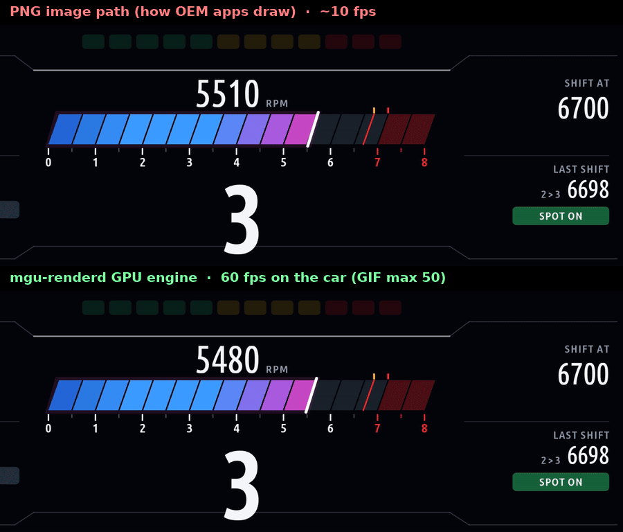<br><sub>Сверху: те же кадры с задержкой до 10 fps, обычной для PNG. Снизу: каждый кадр, рисуемый движком.</sub></p>

| | Штатный путь: PNG | `mgu-renderd` |
|---|---|---|
| **Что отправляет приложение** | сжатое растровое изображение на кадр | несколько КБ графических команд |
| **Кто рисует** | JavaScript на CPU, попиксельно | Intel HD Graphics 505 GPU |
| **Частота** | несколько fps (только PNG: ~60 мс) | **60 fps**, по такту дисплея |
| **Движение** | скачки между значениями | плавные приборы с пружинным сглаживанием |
| **Область экрана** | графический компонент HMI, заголовок и панель 120 px | весь экран: заголовок в полосе HMI, панель 48 px |

**Измерения на реальном автомобиле** (журналы приложений, среднее за 10 секунд):

| Приложение | Частота | GPU на кадр | JavaScript на кадр |
|---|---|---|---|
| M Vitals | 60–61 fps | 1,0–1,3 мс (пик 11 мс) | 2–5 мс |
| eDrive | 60–61 fps | 1,0–1,2 мс | |
| G-Force | 56–61 fps | 1,3 мс | |

При 60 fps кадр длится 16,7 мс, GPU требуется около 1 мс, поэтому запас большой. Статические карточки, шкалы и циферблаты рисуются один раз и кэшируются на GPU. Без движка те же приложения автоматически используют PNG с тем же внешним видом.

```
 app (Node.js)  ──  drawing commands  ──▶  mgu-renderd (C, OpenGL ES 2)  ──▶  own layer above the HMI
     │              Unix socket, per frame        Intel GPU, synced to vsync          (input still goes to the HMI)
     └── buttons, settings, tiles: BMW's own HMI widgets, so the iDrive controller and touch work as usual
```

Подробнее: [как приложения рисуют](#44-how-apps-draw-remote-hmi-rhmi) и [`kit/renderd`](kit/renderd/README.md).

---

<a id="gallery"></a>
## Галерея

<table>
<tr>
<td width="50%">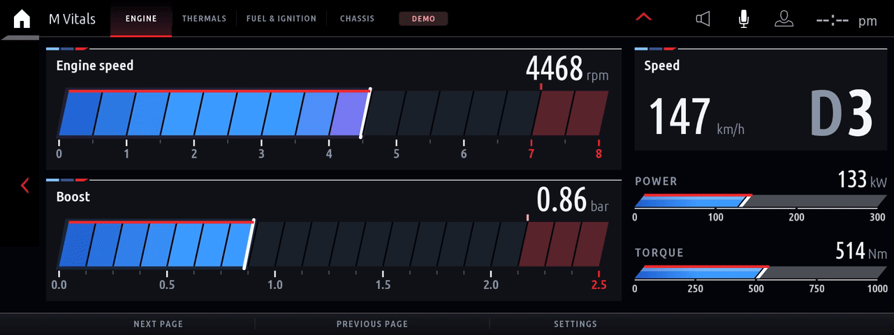<br><b>M Vitals</b>: обороты, наддув, скорость и передача, мощность, момент</td>
<td width="50%">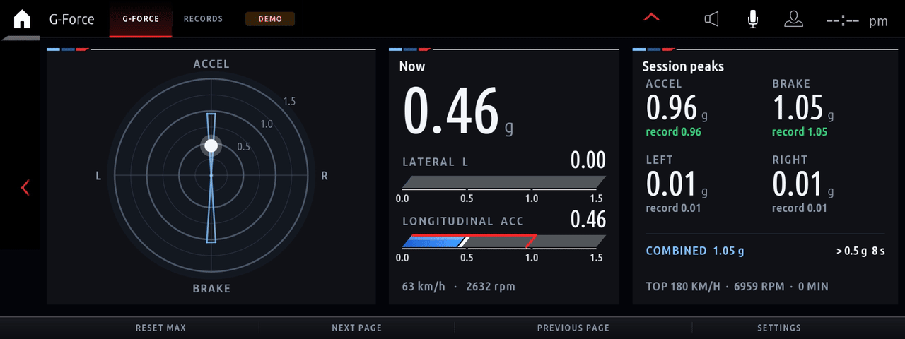<br><b>G-Force</b>: круг сцепления со следом, предел сцепления, пики и рекорды</td>
</tr>
<tr>
<td>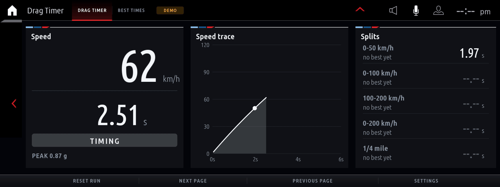<br><b>Drag Timer</b>: график скорости, промежуточные времена, ¼ мили</td>
<td>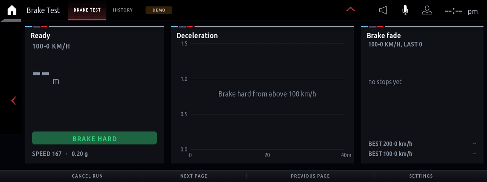<br><b>Brake Test</b>: дистанция 100–0, график замедления, перегрев тормозов</td>
</tr>
<tr>
<td>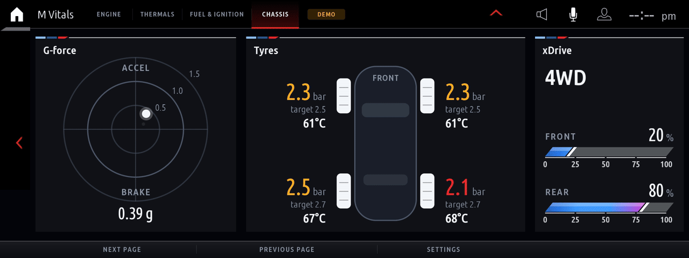<br><b>M Vitals</b>: перегрузка, давление и температура шин, распределение xDrive</td>
<td>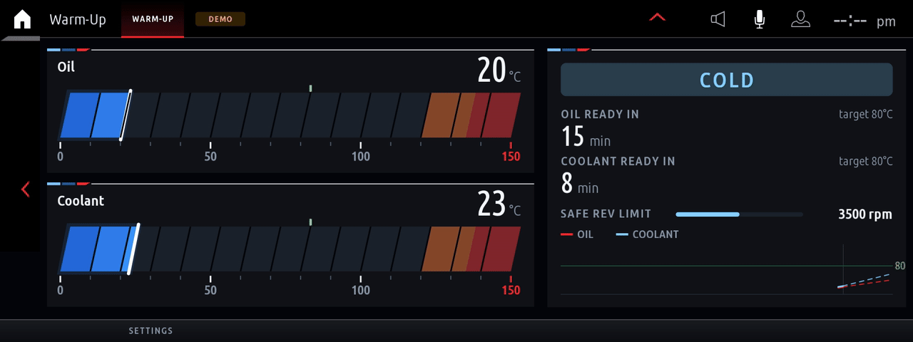<br><b>Warm-Up</b>: время до рабочей температуры, безопасный предел оборотов</td>
</tr>
<tr>
<td>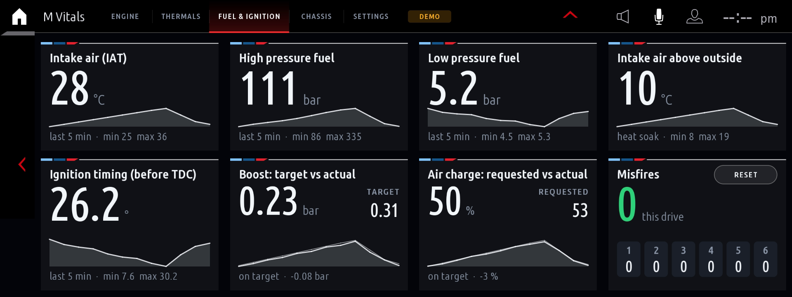<br><b>M Vitals</b>: впускной воздух, давление HPFP/LPFP, зажигание, пропуски по цилиндрам</td>
<td>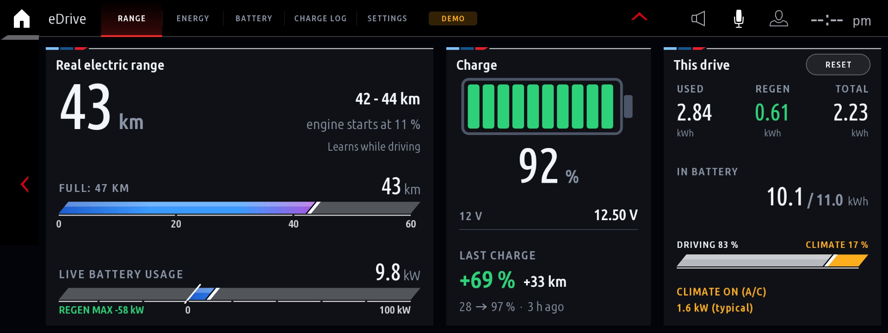<br><b>eDrive</b>: реальный запас хода, состояние батареи, последняя зарядка, 12 В</td>
</tr>
<tr>
<td>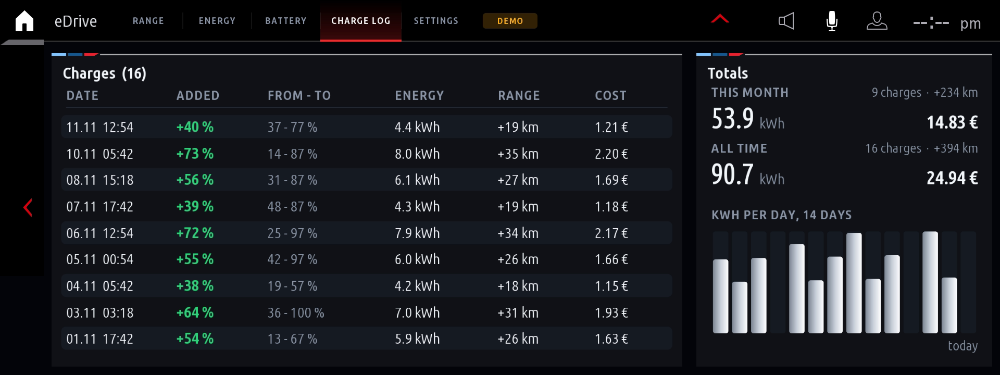<br><b>eDrive</b>: журнал зарядок со стоимостью и итогами</td>
<td>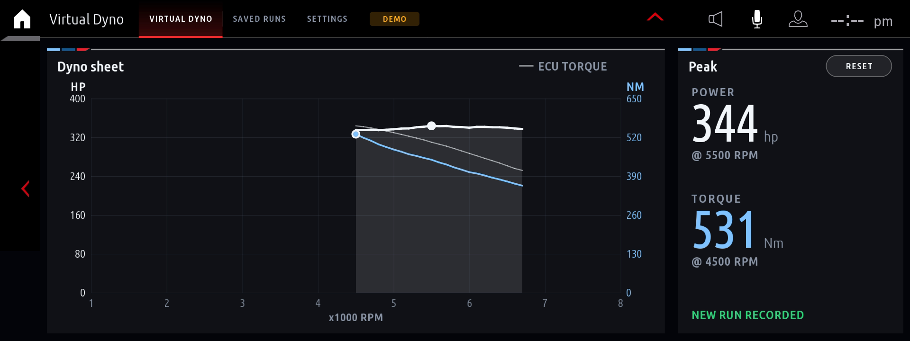<br><b>Virtual Dyno</b>: кривые мощности и момента по заезду</td>
</tr>
<tr>
<td>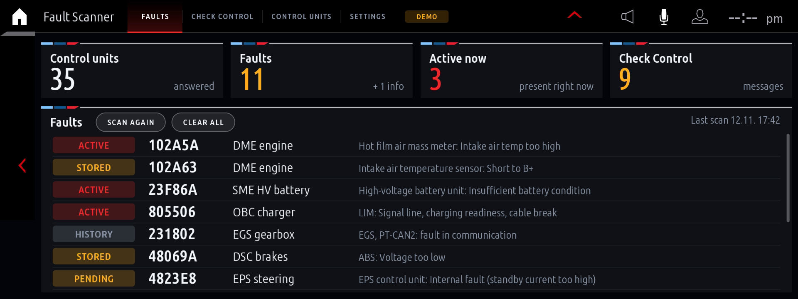<br><b>Fault Scanner</b>: коды ошибок всех блоков с описаниями</td>
<td>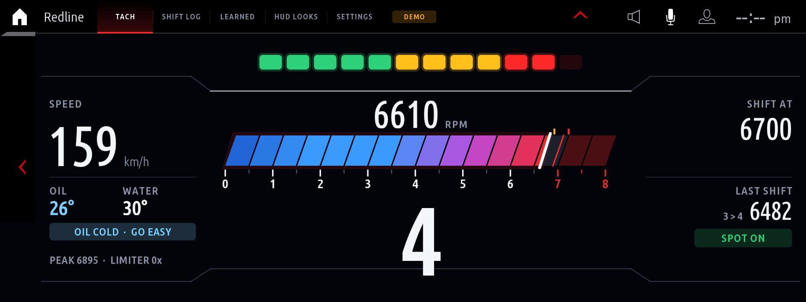<br><b>Redline</b>: шкала в стиле G20, крупная передача, оценка переключений</td>
</tr>
<tr>
<td>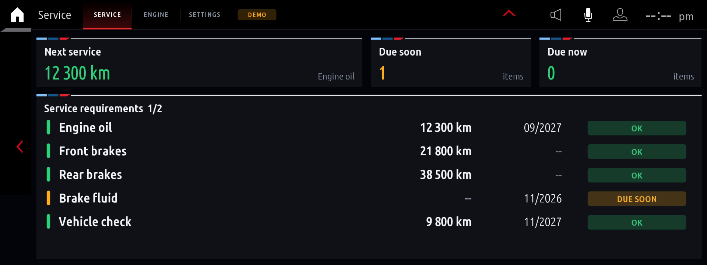<br><b>Service</b>: требования обслуживания, следующий срок, подробности</td>
<td><br><b>Doom</b>: Freedoom во весь экран, управление iDrive, автосохранение</td>
</tr>
<tr>
<td>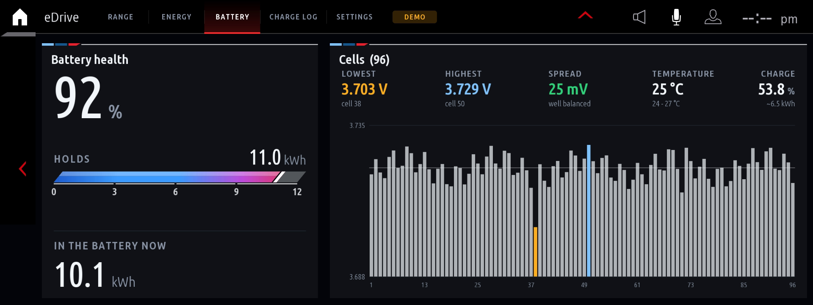<br><b>eDrive</b>: мощность высоковольтной батареи, рекуперация и движение относительно пределов, итоги поездки</td>
<td>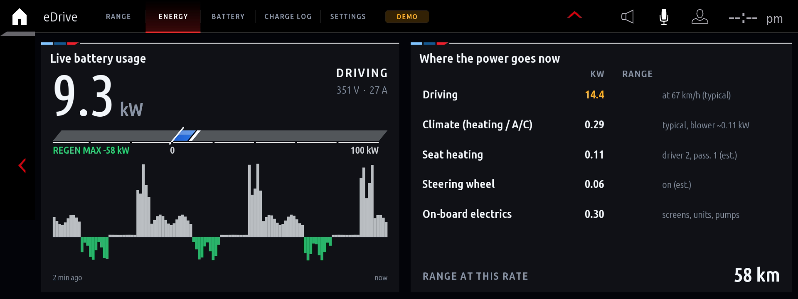<br><b>eDrive</b>: температуры и напряжения ячеек, охлаждающая жидкость, допустимая мощность</td>
</tr>
<tr>
<td>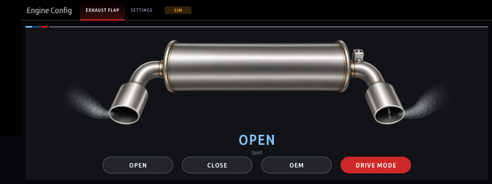<br><b>Engine Config</b>: заслонка выпуска открыта, закрыта или возвращена автомобилю (OEM), состояние подтверждается DME</td>
<td>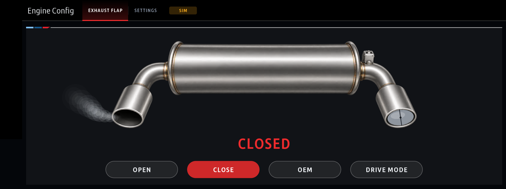<br><b>Engine Config</b>: заслонка закрыта, выбранный режим выделен красным; другие настройки можно добавлять вкладками</td>
</tr>
<tr>
<td>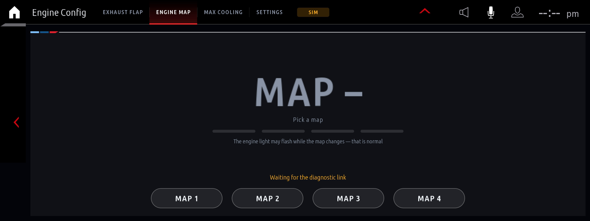<br><b>Live Adjustments</b> (тюнинг DME): выбор прошивки 1–4 одним нажатием, DME подтверждает запрос</td>
<td><br><b>Live Adjustments</b> (тюнинг DME): максимальное охлаждение вкл./выкл.</td>
</tr>
<tr>
<td><br><b>Live Adjustments</b> (тюнинг DME, на автомобиле ещё не проверено): активная прошивка подтверждена чтением из DME</td>
<td><br><b>Live Adjustments</b> (тюнинг DME, на автомобиле ещё не проверено): интенсивность хлопков 0–12 кнопками −/+, отправка по Apply и обратное чтение; Off</td>
</tr>
</table>

<sub>Все анимации записаны офлайн из встроенной демопоездки через собственный код движка (`mgu-renderd --replay`, см. [6.3](#63-preview-build-deploy)), поверх стрелки назад и значков HMI, в теме M Tricolour. GIF воспроизводится не более чем с 50 fps, автомобиль показывает 60. Также доступны темы M Red, Ice White и Night Amber. В автомобиле экраны показывают реальные данные.</sub>

---

## Содержание

- [Графический движок](#not-a-png-slideshow-a-custom-render-engine) · [Галерея](#gallery)
1. [Приложения](#1-the-apps)
2. [Что потребуется](#2-what-you-need)
3. [Быстрый старт](#3-quick-start)
4. [Устройство головного устройства](#4-how-the-head-unit-works)
5. [Установка приложений](#5-how-the-apps-get-onto-the-unit)
6. [Создание своего приложения](#6-writing-your-own-app)
7. [Сигналы автомобиля](#7-vehicle-signals-reference)
8. [Диагностика проблем](#8-troubleshooting-and-gotchas)
9. [Известные ограничения](#9-known-limits)
10. [Структура репозитория](#10-repository-layout)

---

<a id="1-the-apps"></a>
## 1. Приложения

В каждом приложении есть настройки в стиле HMI: четыре темы (M Tricolour по умолчанию, M Red, Ice White, Night Amber), единицы, частота обновления скорости (5 раз в секунду, как у BMW, и до 60) и деморежим. Результаты и рекорды сохраняются на устройстве после перезагрузки.

| Приложение | Назначение |
|---|---|
| **Redline** | Тахометр в стиле G20 Live Cockpit: широкая наклонная сегментная шкала, цифровые обороты, крупная передача, скорость и 12 индикаторов переключения. В точке переключения индикаторы, передача и подсказка SHIFT становятся красными; необязательный режим мигания также вспыхивает всем экраном. Передача читается из КПП или вычисляется по оборотам и скорости. Каждое переключение вверх оценивается как EARLY / SPOT ON / LATE / LIMITER, ведутся журнал и статистика. Холодное масло отмечается всегда; включённая по умолчанию защита снижает точку переключения до прогрева. |
| **Virtual Dyno** | Полный газ на одной передаче даёт кривые мощности и момента с учётом ускорения, массы, аэродинамики и сопротивления качению. Настраиваются масса, кузов, потери, hp/PS/kW и Nm/lb-ft/kgm. Заезды сохраняются; базовый заезд показывает отклонения ± в новых измерениях. Можно наложить момент, сообщаемый ЭБУ. |
| **Brake Test** | 100–0 и 200–0 км/ч (или 60–0 и 100–0 mph): дистанция, время, пиковое замедление и график. Момент пересечения начальной скорости интерполируется между измерениями. График перегрева сравнивает последние остановки и предупреждает о росте дистанции. Есть рекорды и полная история. |
| **Drag Timer** | 0–50, 0–100, 100–200, 0–200 км/ч и ¼ мили (или аналоги в mph), интерполированные промежуточные времена, необязательный вычет первого фута, график скорости и сохранённые рекорды. |
| **G-Force** | Круг сцепления с исчезающим следом и расширяющейся границей сцепления. Боковое и продольное ускорение, пики сессии по направлениям, время выше 0,5 g и абсолютные рекорды. Числа обновляются с заданной частотой (по умолчанию 10 Гц), точка и след — с полной частотой кадров. |
| **Warm-Up** | Приборы масла и охлаждающей жидкости, расчёт минут и времени до рабочей температуры по измеренной скорости прогрева (до накопления данных — типовые значения, при электродвижении — «двигатель выключен») и температурный график. Безопасный предел оборотов растёт с температурой масла. После интенсивной езды отсчитывается охлаждение турбины: 30 секунд–3 минуты спокойной езды в зависимости от длительности нагрузки. |
| **M Vitals** | Многостраничная спортивная панель: обороты, наддув (давление в bar, psi или kPa), скорость и передача (D/S/M + номер), мощность со спортдисплея (% × максимум автомобиля, поэтому подходит стоку и тюнингу; kW/hp/PS), момент (Nm/lb-ft), температуры и перегрузки с пиками. Страница Fuel & ignition показывает IAT, давление HPFP/рейки и LPFP, зажигание, целевой/фактический наддув и запрошенный/фактический заряд воздуха с пятиминутными графиками (DME DID 4AB0/580B/480C/5813, запасной OBD PID 0x70), пропуски каждого цилиндра за цикл (OBD 06) и превышение температуры впуска над наружной. Thermals добавляет температуру EGS (`config.dme.egs`). Элементы имеют режимы Auto/Show/Hide и делят пространство. На Chassis крупно показаны давление относительно цели и температура шин. xDrive можно показывать автоматически при обнаружении полного привода, принудительно или скрыть. Без штатного сигнала распределения читается момент передней оси из LMV (UDS `22 DB32`, `config.xdrive`) и оценивается по моменту двигателя и передаче; источник указан. Недостоверные и неизменные значения считаются отсутствием данных, исходные значения пишутся в журнал для калибровки `config.scaling`. Наддув берётся со спортдисплея или из DME через OBD (давление наддува/коллектора минус атмосферное, кандидаты `config.dme.boost`), источник можно выбрать вручную. Приборы меняют цвет от синего к красному возле пределов. |
| **Fault Scanner** | Сканирует все блоки через диагностический шлюз UDS, показывает ошибки и статусы по модулям, активные сообщения Check Control и очищает память после двойного подтверждения. Описания берутся из экспорта coding-tool (`kit/tools/dtc_texts.py`), нескольких ручных записей и необязательной базы всех блоков (`--db`): у блоков с ошибками запрашивается SGBD-индекс (UDS 22 F1 50) для выбора имени и описаний. Импортируются только английские тексты, немецкие пропускаются. CSV (`--codes`) дополняет недостающие описания соответствующих блоков. Таблицы `dtc_scanner_*.json` (`dtc_tables.py` после `--db`) добавляют описания по типу и адресу. Сборка сжимает базу примерно из 19 МБ в 3,7 МБ `dtc_db.pack` (`pack_data.py`), приложение распаковывает только нужные килобайты. Готовая база уже включена в `apps/dtc_scanner/dtc_db.pack` с разрешения; локальная папка `dtc_db/` заменяет её. Импортированные базы и экспорты не попадают в git. **Русский перевод покрывает интерфейс и имеющиеся полные описания; неизвестные описания остаются английскими. Исходная английская база не изменяется.** |
| **eDrive** | Для PHEV/EV: реальный запас хода от заряда выше точки запуска двигателя, расхода на км (обучение на последних ~60 км электродвижения по скоростным диапазонам) и часового потребления климата и бортовой сети (обучение по наружной температуре на месте и в пробках). Запас учитывает текущий темп, поэтому на трассе меньше, чем в городе. Климат также изучается в движении относительно той же скорости без него; учитываются уровни подогрева сидений и руля. Energy показывает расход по скоростям, текущее распределение мощности с потерями километров, штатное распределение и температуру батареи. Климат расходует запас по часам, поэтому в пробке сильнее; показываются kW и потерянные км. Состояние читается из ClimateMaster `statusClimateSystemOn`: выключенный климат увеличивает запас, включённый уменьшает (CLIMATE ON/OFF и A/C). До обучения используется оценка по наружной температуре (полный заряд: 50 км при 20 °C, 40–45 при 10 °C, 30–38 при 0 °C, 20–30 при −10 °C, масштабирование под ваш запас при 20 °C), диапазон, SOH в % и kWh и текущая энергия. Ёмкость новой батареи настраивается (например, 12 kWh для 330e/530e, 24 для X5 45e). Показаны последняя зарядка (+% , kWh, км; зарядка во сне появится при запуске) и 12 В. Журнал содержит каждую зарядку, стоимость по тарифу (0,25 €/kWh по умолчанию), месячные и общие итоги и график за 14 дней. Без гибридной системы отображается только 12 В (или Hybrid system = No). Заряд и SOH читаются через UDS; Diagnostics показывает исходные ответы для настройки DID в `app.json`. |
| **eDrive: живые страницы** | `apps/edrive/live.js` настроен для X5 xDrive45e (24 kWh) и изменяется для других PHEV. **Батарея:** мощность в kW (напряжение × ток каждую секунду; + движение, − рекуперация/зарядка), шкала от допустимой рекуперации до допустимой тяги, двухминутный график, температуры ячеек и ОЖ, напряжение каждой ячейки с минимумом, максимумом и разбросом. Поездка: расход, рекуперация, итог, доли движения и климата, пики; Reset drive totals начинает новую. **Климат на Energy:** на месте с выключенным двигателем и без зарядки разница потребления с базовой бортовой нагрузкой показывает реальный обогрев/охлаждение и заменяет оценку (либо используются данные блока климата). SME UDS: `DD68` напряжение, `DD69` ток, `DDBF` напряжения ячеек, `DDC0` температуры, `DD6C` ОЖ, `DD7D` пределы тока (идентификаторы BMW в расшифровке OVMS для i3); `powerSign` меняет направление тока. **Виджет главного экрана** показывает мощность, состояние, V/A, заряд, шкалу, ячейки и поездку (большой) или те же строки (малый); Battery unit и Scan управляются настройкой Diagnostics pages. |
| **Service** | Требования BMW Condition Based Service, как в *Vehicle status → Service requirements*: масло, тормоза, жидкость, осмотр, ТО и остальное, с расстоянием и датой в языке и единицах автомобиля, зелёным/жёлтым/красным цветом, сводкой следующего обслуживания и подробными подсказками. Данные читаются из приборной панели (`KombiInterface_2`). Только чтение: сброс выполняется в меню панели или в сервисе. |
| **Doom** | Freedoom: Phase 1 (четыре эпизода, свободные данные) через WebAssembly. 3D во всём экране 1920 × 504 с расширенным вертикальным углом обзора, статус и меню 4:3 поверх; 35 fps на VM. Сначала главное меню (Play/Continue, New game, настройки), затем игра занимает экран без панелей, BACK возвращает в меню. **Поворот контроллера — прицеливание, наклон — движение и стрейф, нажатие — огонь и двери, двойное нажатие — следующее оружие.** Во время игры HMI не реагирует на контроллер; BACK, MENU и сенсорный экран работают всегда. Это обеспечивает gate, устанавливаемый `deploy-car.sh` (см. [5.1](#51-what-deploy-carsh-install-does)); без него HMI также получает действия. Игра ставится на паузу и сохраняется при уходе или перекрытии экрана. Настройки: сложность, эпизод, скорость движения и прицеливания, направление, разрешение. GPL-2.0, см. [лицензии](#doom-and-renderer-licences). По умолчанию **только на стоянке**; во время движения игра сохраняется и ждёт (Parked only можно отключить). |
| **Engine Config** | Изменения двигателя вкладками, начиная с **Exhaust Flap**: Open, Close или OEM с крупным состоянием и схемой патрубков. **Безопасно по умолчанию:** настройка поставляется **Disarmed** (симуляция, ничего не затрагивает); **Armed** выбирайте только после проверки команды на своём автомобиле. На совместимом DME заслонка управляется через UDS `2F 60FD` «EL_AGK» (Bosch MG1/DME8 для B48/B58/S58 на MGU ID7; OPEN 10%, CLOSE 90%, OEM возвращает управление, DME сам завершает override примерно через 20 с). Команда подтверждена на реальном автомобиле, другие DME не проверены. **Тюнинг DME (экспериментально):** выберите Off/BM3/MHD в Settings (по умолчанию Off, ничего не отправляется). BM3 — прошивки 1–4 и хлопки (запись и обратное чтение только после распознавания CustomROM) и Active Sound; MHD — прошивки 1–4 и Max Cooling с подтверждением DME. Можно добавить другие тюнинги, см. README приложения. **xDrive (экспериментально, Off):** отключает xDrive до следующего цикла зажигания через `LMV_FUNKTION` DSC (issue #28), только с выключенным двигателем, в P, с ручником, на месте и после двух нажатий. DSC сообщает AWD/RWD после запуска, цикл зажигания восстанавливает xDrive. |

**Экспериментально:** [Transmission Config](apps/zf8hp/README.md) (ZF 8HP) читает адаптации муфт, карты переключений, температурную историю и текущие данные; только чтение, требуется проверенный вариант EGS, есть ограниченная проверка G22 (гибридная 8HP G20 330e также читается) и метка EXPERIMENTAL. Синтетическое демо явно обозначено и выключено по умолчанию. Вкладки тюнинга [Engine Config](apps/live_adjustments/README.md) (BM3/MHD) тоже экспериментальны: запросы отправляются только после выбора тюнинга в Settings. Прочитайте замечания о совместимости.

На VM или стенде без данных панели через 5 секунд переключаются на встроенную демопоездку: старт, разгон по передачам, резкая остановка, повороты и прогрев. Метка **DEMO** показывает, что данные не из автомобиля.

---

<a id="2-what-you-need"></a>
## 2. Что потребуется

**В автомобиле**

- **BMW с MGU** (iDrive 7, ID7). Разработано и проверено на прошивке `P18_23w44.2`; другие версии MGU, вероятно, тоже подойдут. Команда установщика `check` сообщит о совместимости до изменений.
- **Root shell на головном устройстве** (SSH или последовательная консоль). **Проект не предоставляет такой доступ и не публикует способ его получения.** Ищите руководства сообщества по root для MGU. Далее предполагается вход как `root`.
- **BMW App SDK (`oap-sdk`), извлечённый из вашего устройства.** Это защищённый код BMW, его нет в репозитории. Он находится в каждом приложении BMW, а [`kit/tools/extract_sdk.js`](kit/tools/extract_sdk.js) восстанавливает SDK из одного приложения за секунду.

**На компьютере**

Windows, macOS или Linux; нужны только **Python** и **Node.js**, без Linux, компилятора и Docker. GPU-движок уже [скомпилирован](kit/renderd/prebuilt), а сборщик проверяет его соответствие исходникам.

| Инструмент | Для чего | Обязателен? |
|---|---|---|
| **Python 3.6+** | `build.py` упаковывает приложения, `make_kit.py` собирает комплект | да |
| **Node.js 14+** | сборка значков, `extract_sdk.js`, `preview.js` | да |
| **ssh / scp** (OpenSSH) | установка (`push-to-car.sh` / `push-to-car.ps1`) | да: встроен в Windows 10/11, macOS и Linux |
| **Docker** | пересборка `mgu-renderd` | только при изменении C-кода движка |
| **ffmpeg**, **bash** | `make_gif.sh` для анимаций | необязательно |
| **Pillow** (`pip install pillow`) | повторное создание шрифтовых атласов | необязательно |

npm-пакеты не нужны: используются только стандартные библиотеки Node и Python.

**Windows:** установите Python с [python.org](https://www.python.org/downloads/) (отметьте *Add python.exe to PATH*) и Node.js LTS с [nodejs.org](https://nodejs.org/).

**macOS:** `brew install python node` или установщики с тех же сайтов.

**Ubuntu / WSL:** `sudo apt install python3 nodejs openssh-client`. Требуется Node.js 14+: Ubuntu 24.04 содержит 18; в 22.04 и старше версия слишком старая, используйте nodejs.org или nvm.

Проверка:

```sh
python3 --version     # Windows: python --version
node --version
```

**При изменении движка** (`kit/renderd/src`) нужен Docker ([Docker Desktop](https://www.docker.com/products/docker-desktop/) на Windows/macOS, [Docker Engine](https://docs.docker.com/engine/install/) на Linux). Сборка выполняется в Ubuntu 18.04 для совместимости с библиотеками устройства (первый раз ~550 МБ и несколько минут), всегда x86-64, включая ARM-компьютеры и Apple Silicon. Затем обновляется готовый бинарник для коммита. Если исходники изменились, а собрать невозможно, сборщик предупредит и спросит перед использованием старого движка.

---

<a id="3-quick-start"></a>
## 3. Быстрый старт

<a id="31-get-the-sdk-from-your-unit"></a>
### 3.1 Получение SDK из устройства

Скопируйте штатное приложение x_call и извлеките SDK:

```sh
scp root@<unit>:'/usr/lib/oap-mainapp/preinstalled_apps/x_call@*.tgz' .
mkdir x_call && tar xzf x_call@*.tgz -C x_call
node kit/tools/extract_sdk.js x_call/javascript/app.js     # создаёт ./oap-sdk/
```

В PowerShell команды те же (scp и tar встроены), но подставьте реальное имя вместо `x_call@*.tgz`.

| Путь | Содержимое |
|---|---|
| `oap-sdk/index.js`, `package.json` | runtime, добавляемый сборкой в каждое приложение (`require('oap-sdk')`) |
| `oap-sdk/source/` | все модули SDK в читаемом виде по исходным путям |

SDK 24.10.x из прошивки имеет полный публичный API. Более новый x_call (`/var/opt/public/oap/oap_12204/source/javascript/app.js`) может содержать SDK без `telephony`, `appstart`, `map` и `poi`; приложениям комплекта они не нужны, а инструмент перечислит отсутствующее. `oap-sdk/` находится в `.gitignore` и не должен попадать в коммит.

<a id="32-build"></a>
### 3.2 Сборка

```sh
python3 kit/tools/build.py            # все приложения на английском -> dist/<id>@<ver>.mgu
python3 kit/tools/build.py redline    # одно приложение на английском
python3 kit/tools/build.py --language ru       # русский -> dist/<id>@<ver>-ru.<revision>.mgu
python3 kit/tools/build.py --language zh-CN    # упрощённый китайский -> dist/<id>@<ver>-zh.cn.2.mgu
node kit/tools/preview.js dist/redline preview wait=10   # английский предпросмотр -> preview/*.png
```

В Windows используйте `python` вместо `python3`.

По умолчанию собирается пакет только с английским интерфейсом. Язык каждого пакета фиксируется при сборке: настройки **Settings → Language**, переключения во время работы и многоязычных подмножеств через `--languages` нет. Для русской сборки используйте `--language ru` с `build.py` или `make_kit.py`; версия получает языковой суффикс (`dist/<id>@<ver>-ru.<revision>.mgu`). Команда `--language zh-CN` сохраняет прежнее поведение фиксированной китайской сборки. Установка пакета на другом языке заменяет приложение как обновление.

Каждый пакет содержит все **33 таблицы локалей HMI**, во всех таблицах заполнены все 256 слотов `SID_CN_DYNAMIC`. Существующие китайские ресурсы и поведение credit не меняются; небольшой кириллический атлас добавляется только с `ru`. Русский перевод охватывает интерфейс всех приложений и имеющиеся полные описания Fault Scanner; неизвестные описания остаются английскими. Китайский перевод базы включён в сборку `zh-CN`. `kit/tools/import_diagnostic_ru.py` импортирует более полный русский каталог из ваших EN/RU-баз `DiagDocDb`, не изменяя исходный английский `dtc_db.pack`.

Китайский перевод: 小白151 ([JackieZ123430](https://github.com/JackieZ123430), [idrive7-apps-cn](https://github.com/JackieZ123430/idrive7-apps-cn)); руководства: [English](README.md), [中文](README.zh-CN.md).

Файлы `.mgu` содержат SDK BMW — используйте их только для своего автомобиля и не публикуйте.

<a id="33-install-on-the-car"></a>
### 3.3 Установка в автомобиль

Автомобиль на стоянке, зажигание включено, желательно подключить зарядное устройство. Сначала соберите приложения, установщик и GPU-движок в `dist/mgu-custom-apps.tar.gz`:

```sh
deploy/make-car-kit.sh                 # macOS / Linux / WSL: все приложения на английском
deploy\make-car-kit.cmd                # Windows (cmd или PowerShell)
python3 kit/tools/make_kit.py redline  # любая ОС; только выбранные приложения на английском
python3 kit/tools/make_kit.py --language ru       # русский комплект -> dist/mgu-custom-apps-ru(.tar.gz)
python3 kit/tools/make_kit.py --language zh-CN    # китайский комплект -> dist/mgu-custom-apps-zh-CN(.tar.gz)
```

Для комплекта с суффиксом передайте `push-to-car.sh` соответствующий `KIT=dist/<папка-комплекта>`, а `push-to-car.ps1` — `-Kit dist\<файл-комплекта>.tar.gz`.

Затем отправьте по SSH. macOS / Linux / WSL:

```sh
HU=root@<unit-ip> PORT=22 KEY=~/.ssh/id_mgu deploy/push-to-car.sh check    # только проверка и список изменений
HU=root@<unit-ip> PORT=22 KEY=~/.ssh/id_mgu deploy/push-to-car.sh install  # резервная копия -> установка -> перезапуск платформы
HU=root@<unit-ip> PORT=22 KEY=~/.ssh/id_mgu deploy/push-to-car.sh restore  # откат к резервной копии
```

`KEY` — закрытый SSH-ключ устройства (`chmod 600`). Он нужен каждой команде, если ключ уже не настроен в `~/.ssh/config` или ssh-agent.

**Windows:** `deploy/push-to-car.ps1` использует системный OpenSSH и ключ, созданный [idrive7-8-ssh-root](https://github.com/cauliflowermossgrape/idrive7-8-ssh-root) (`data\enrollments\<VIN>\id_rsa`; IP находится рядом в `connect.txt`):

```powershell
powershell -ExecutionPolicy Bypass -File deploy\push-to-car.ps1 check   -Key <path>\id_rsa -Ip <unit-ip>
powershell -ExecutionPolicy Bypass -File deploy\push-to-car.ps1 install -Key <path>\id_rsa -Ip <unit-ip>
```

По умолчанию берётся `dist\mgu-custom-apps.tar.gz`, другой файл задаётся через `-Kit <path>`. Без сети скопируйте `dist/mgu-custom-apps/` на USB и на устройстве выполните `sh deploy-car.sh check`, затем `sh deploy-car.sh install`.

Через 1–2 минуты плитки появятся в **Apps**. Другие команды в `/var/opt/mgu-custom-apps`:

```sh
sh deploy-car.sh status     # приложения, состояние и hook
sh deploy-car.sh backups    # резервные копии
sh deploy-car.sh restore    # возврат к заводскому состоянию (введите YES)
```

<a id="34-doom-the-extra-steps"></a>
### 3.4 Doom: дополнительные шаги

Doom устанавливается так же и входит в комплект, если не перечислены только другие приложения. Есть четыре отличия:

1. **Данные игры скачиваются один раз.** WAD не хранится в git. Первый `build.py` / `make-car-kit` скачивает Freedoom: Phase 1 0.13.0 (ZIP 24 МБ с [страницы релизов](https://github.com/freedoom/freedoom/releases/tag/v0.13.0)), проверяет SHA-256 и сохраняет `apps/doom/freedoom1.wad`; далее файл используется повторно. Без интернета скачайте `freedoom-0.13.0.zip` на другом компьютере и поместите `freedoom1.wad` в `apps/doom/`. Другой WAD, включая оригинальный `doom.wad`, не пройдёт проверку.
2. **Пакет больше** — около 11 МБ (движок и данные), отправка займёт немного больше времени.
3. **Для полного экрана нужен GPU-движок.** Комплект устанавливает его; без него Doom использует меньшее изображение в обычной области приложения.
4. **В конце установки устройство один раз перезагружается для controller gate.** `deploy-car.sh install` настраивает загрузку `mgu-inputgate.so` в HMI, чтобы игра единолично получала контроллер (см. [5.1](#51-what-deploy-carsh-install-does)). Gate загружается при старте: экран гаснет примерно на минуту, затем всё возвращается. При проблеме HMI gate автоматически исключается. Для отложенной перезагрузки: `NO_REBOOT=1 sh deploy-car.sh install`. Если gate не нужен: `NO_INPUTGATE=1 sh deploy-car.sh install`; Doom будет работать, но HMI тоже будет реагировать на контроллер.

```sh
python3 kit/tools/build.py doom                       # первый запуск скачает WAD
deploy/make-car-kit.sh doom                           # только Doom; без аргументов — все приложения
HU=root@<unit-ip> PORT=22 KEY=~/.ssh/id_mgu deploy/push-to-car.sh install
```

В автомобиле **Apps → Doom** открывает меню. Первый запуск занимает несколько секунд на компиляцию. Сохранения остаются при переустановке того же приложения, но удаляются командой `restore`.

<a id="35-back-to-stock"></a>
### 3.5 Возврат к заводскому состоянию

`restore` останавливает платформу, удаляет приложения, hook и настройки загрузки, затем восстанавливает каждый изменённый файл из **заводской резервной копии** — самой первой копии `install`, которая никогда не перезаписывается. Файлы проверяются по копии. Наконец HMI перезапускается, чтобы плитки исчезли без перезагрузки.

---

<a id="4-how-the-head-unit-works"></a>
## 4. Устройство головного устройства

Ниже — важная для приложений внутренняя структура MGU, изученная на работающем устройстве.

<a id="41-hardware"></a>
### 4.1 Аппаратная часть

| Компонент | Описание |
|---|---|
| CPU | Intel Apollo Lake (x86-64), Intel GPU (i915/Mesa, EGL + GLES2) |
| ОС | Linux 4.14 (`-apl`), systemd, BusyBox |
| Память | eMMC: корень только для чтения и записываемый `/var/opt` (приложения в `/var/opt/public`). HDD 2,5": раздел навигации только для чтения и записываемый общий раздел ~90 ГБ `/var/opt/hdshare`. |
| Видеовход | Intel IPU4 с шестью CSI-2; на исследованном устройстве камеры не подключены, изображение приходит по Ethernet (см. 4.6) |
| Сеть | Ethernet в автомобиль (`socnet0`), VLAN для доменов; Wi-Fi (`wlan0`) для точки доступа/CarPlay |

<a id="42-software-stack"></a>
### 4.2 Программный стек

```
 ┌───────────────────────────── HMI (HmiMain3D, RAMSES 3D renderer) ─────────────────────────────┐
 │  BMW's screens and menus   +   "Remote HMI" (RHMI) screens that apps describe and fill with data │
 └───────────────▲──────────────────────────────────────────────────────────▲────────────────────┘
                 │ SOME/IP + joynr                                             │ SOME/IP
 ┌───────────────┴──────────────┐   ┌──────────────────────────────────────┴─────────────────────┐
 │  OAP app platform            │   │  Native services                                             │
 │  oapcontroller -> MainApp    │   │  media (mediaengine, mediaapp), cameras (dasvideo,           │
 │  (Node.js) -> one Node       │   │  icam2proxy), AVB streams, navigation, phone, diagnostics    │
 │  process per app             │   │  gateway (TASU), provisioning, connectivity (connman)        │
 └───────────────┬──────────────┘   └──────────────────────────────────────┬─────────────────────┘
                 │                     SOME/IP over Ethernet VLANs            │
 ┌───────────────┴────────────────────────────────────────────────────────────┴─────────────────┐
 │  The rest of the car: engine and chassis data, instrument cluster, cameras, telematics (TCB)   │
 └───────────────────────────────────────────────────────────────────────────────────────────────┘
```

- **SOME/IP** (vsomeip) — основная шина. Каждый сервис описан в `/etc/oap/someip/someip-interfaces.json`: интерфейсы, поля (getter и уведомления), методы, события, идентификаторы и типы. Обороты, скорость, температуры и ускорения приходят как уведомления полей.
- **joynr** — RPC поверх SOME/IP (cluster controller BMW слушает порты 4242/4243); используется для управления приложениями и входными точками HMI.
- **HMI** — 3D-движок RAMSES с ресурсами BMW. Приложения описывают экраны шаблонами виджетов и передают текст, изображения и свойства (см. 4.4).

<a id="43-the-app-platform-oap"></a>
### 4.3 Платформа приложений (OAP)

BMW называет её **Online Apps Platform**. Так работают штатные погода, новости, M Laptimer, экстренный вызов, сервисные и батарейные приложения; проект использует тот же механизм.

- `oapcontroller.service` запускает **MainApp** (`/usr/lib/oap-mainapp`, Node.js, uid 12201), который устанавливает, запускает, останавливает и контролирует приложения.
- **Каждое приложение — npm-пакет** (`package.json`, `manifest.json`, `permissions.json`, `rhmiData/`, `javascript/app.js`) в `/var/opt/public/oap/oap_<uid>/`, работающий под отдельным пользователем (uid 12203+). На устройстве Node.js 8 и нативные расширения SOME/IP, сертификатов, кодирования и др.
- **Реестр:** `oap_12201/security/uids.txt` (uid ↔ приложение) и `oap_12201/data/apps/<app>.json` (версия, источник, состояние).
- **Источники установки:** магазин BMW или `/usr/lib/oap-mainapp/preinstalled_apps/`. MainApp создаёт SOME/IP-конфигурацию и ACL из `manifest.json` и каталога. Приложение видит только запрошенные сервисы и поля.
- **Provisioning управляет видимостью.** Подписанный BMW `/var/opt/public/tm/tm_12000/data/prov/ProvSigned.xml` перечисляет разрешённые приложения и функции. Подпись нельзя просто изменить, поэтому комплект добавляет fallback (см. 5.2).
- **Обработка сбоев строгая.** При неожиданном выходе `CorruptAppsHandler` стирает данные приложения, при повторном — удаляет его. Не завершайте процессы вручную; перезапускайте платформу `systemctl restart oapcontroller`.
- Ограничения CPU, памяти и диска задаются в `oapAppSettings` в `package.json`.

<a id="44-how-apps-draw-remote-hmi-rhmi"></a>
### 4.4 Как приложения рисуют: Remote HMI (RHMI)

HMI не выполняет код приложения. Пакет содержит описание экранов:

- `rhmiData/application.json`: идентичность и входные точки (плитки Apps: значок, название, позиция).
- `rhmiData/uiDescriptions/ID7/application.xml` + `uiDescription.json`: состояния из компонентов (метки, кнопки, списки, флажки, изображения) на шаблонах BMW (`LT_State_*`, `LT_Label_*`, `LT_Button_*`, ...).
- Во время работы приложение передаёт текст, видимость, доступность, строки и изображения.

Главный экран комплекта — большой графический компонент, который приложение рисует само одним из двух автоматически выбираемых способов:

- **GPU, 60 fps** ([`kit/renderd`](kit/renderd/README.md)). `kit/runtime/record.js` записывает прямоугольники, градиенты, дуги, линии, глифы и кэшированные слои и передаёт их `mgu-renderd` через Unix socket. Движок рисует OpenGL ES 2 в собственном слое поверх HMI и запрашивает следующий кадр после обработки предыдущего композитором. Статика кэшируется в GPU-текстурах, приборы сглаживаются пружиной. Watchdog скрывает приложение, переставшее отправлять кадры.
- **PNG fallback.** Без сервиса (или Renderer = Software) та же запись обрабатывается растеризатором JavaScript (`kit/runtime/canvas.js`), кодируется в PNG и передаётся HMI с 4–15 fps. Внешний вид тот же, заголовок и панель остаются штатными.

С движком по умолчанию используется весь экран (Screen layout = Full screen):

```
 ┌──┬──────────────────────────────────────────────────────┬───────────────────────┐
 │H │ M Vitals  ENGINE  THERMALS  FUEL & IGN.  CHASSIS │ HMI status strip       │  header: app name + page tabs
 ├──┼──────────────────────────────────────────────────────┴───────────────────────┤
 │  │                                                                              │
 │ <│                       page content, scaled up to fill                        │
 │  │                                                                              │
 ├──┴──────────────────────────────────────────────────────────────────────────────┤
 │      NEXT PAGE          PREVIOUS PAGE          SETTINGS                          │  slim 48 px bar
 └─────────────────────────────────────────────────────────────────────────────────┘
```

- **Заголовок** в чёрной полосе HMI занимает только ширину имени, вкладок и меток (DEMO). Справа полоса прозрачна, поэтому штатные радио, телефон, уведомления, громкость, голос, профиль и часы работают.
- **Панель кнопок** высотой 48 px вместо 120 рисуется комплектом поверх штатных кнопок, поэтому сенсорный ввод и контроллер работают как раньше. `Focusable=3` сообщает фокус и подсвечивает выбранную кнопку.
- Стрелка назад и Home остаются видимыми. Всплывающие окна HMI скрывают поверхность движка.
- Screen layout = Standard сохраняет штатный заголовок и панель 120 px; движок покрывает только область изображения.

Кнопки и настройки — обычные RHMI-виджеты с привычным управлением. Справочник: [`docs/rhmi-widgets.md`](docs/rhmi-widgets.md).

<a id="45-diagnostics"></a>
### 4.5 Диагностика

Сервис SOME/IP `com.harman.infotainment.systemfunctions.tasu.tasu.InternalTasu` отправляет **UDS-запросы** любому блоку или всем через функциональный адрес `0xDF`. Ответы приходят событиями. Штатные диагностические задания BMW используют тот же путь.

- Чтение ошибок: `0x19 02 <mask>` (ReadDTCInformation по маске статуса)
- Очистка: `0x14 FF FF FF` (ClearDiagnosticInformation)
- Чтение данных: `0x22 <DID>` (например, `F190` = VIN)

Очистка во всех модулях может перезапустить блоки и само головное устройство.

<a id="46-media-cameras-and-the-drive-recorder"></a>
### 4.6 Медиа, камеры и Drive Recorder

- Аудио и видео передаются по **AVB** поверх Ethernet. Сетевой чип использует драйвер `igb_avb` и направляет потоки обработчику BMW.
- Изображения камер — **H.264 поверх AVB**, отображаются `dasvideo` только при активном просмотре.
- **Drive Recorder** (`VideoBuffer` через `icam2proxy`) требует одновременно coding flag и BMW provisioning (`oap_drive_recorder` в подписанном файле). Только кодирование не создаёт сервис.

<a id="47-connectivity"></a>
### 4.7 Подключение

У головного устройства нет собственного интернет-маршрута. Серверы BMW доступны через **телематический блок (TCB)** и внутренний VLAN. Если мобильной связи нет (например, eSIM автомобиля из США не работает в Европе), устройство офлайн: provisioning и штатные онлайн-приложения не работают. Этим приложениям интернет не нужен.

---

<a id="5-how-the-apps-get-onto-the-unit"></a>
## 5. Как приложения попадают на устройство

<a id="51-what-deploy-carsh-install-does"></a>
### 5.1 Что делает `deploy-car.sh install`

1. **Проверяет** устройство и тестирует patch MainApp для конкретной прошивки. При неожиданном результате останавливается до изменений.
2. **Создаёт резервные копии** всех затрагиваемых файлов в `backups/<time>/` рядом со скриптом и `/var/opt/public/mgu_custom_backup/<time>/`, затем проверяет обе. Первая копия сохраняется как заводская.
3. **Включает provisioning hook** (5.2) и сохраняет его после перезагрузок через systemd drop-in для `oapcontroller.service`.
4. **Устанавливает** каждый `.mgu` в `/var/opt/public/oap/oap_<uid>/` (uid 12221+, не затрагивая BMW), создаёт SOME/IP и ACL **штатным генератором из прошивки**, регистрирует приложение как preinstalled и исправляет владельца и права.
5. **Устанавливает GPU-движок** `mgu-renderd` как systemd service, запускаемый с платформой. Он работает от root в группе композитора (foreground gate определяет активное приложение через SOME/IP; маршрутизация касаний использует nft). Также создаёт **шаблон страницы** из HMI (до 2 минут; монтируется из `/run` перед запуском HMI за boot guard, разделы не изменяются; `NO_EMBED=1` пропускает). См. [kit/renderd](kit/renderd/README.md#using-it-in-an-app). Без движка приложения продолжают работать через программный рендеринг.
6. **Настраивает controller gate** `mgu-inputgate.so` для HMI (drop-in `hmi.service`, другие preload сохраняются). Когда полноэкранное приложение запрашивает контроллер (Doom), HMI получает нейтральные значения, а приложение — реальные события через движок. BACK, MENU и сенсорный экран не блокируются. Gate действует только при свежем маркере `/run/mgu-renderd/inputgate` от видимого запрашивающего приложения. После закрытия, сбоя, popup или остановки движка HMI получает контроллер обратно за 0,7 с. HMI не перезапускается отдельно: SIGABRT вызывает перезагрузку всего устройства. Поэтому gate загружается при следующем старте через `mgu-inputgate-guard.service`; `mgu-inputgate-check.service` проверяет HMI через 2 минуты, после двух неудач guard отключает gate. `status` показывает состояние; `NO_INPUTGATE=1` пропускает настройку.
7. **Перезапускает платформу** один раз. Список Apps обновляется за 1–2 минуты. Если gate только что настроен, через 10 секунд после установки вместо этого происходит **перезагрузка**. `NO_REBOOT=1` откладывает её.

Изменяемые файлы:

```
/var/opt/public/oap/oap_12201/security/uids.txt          app id list
/var/opt/public/oap/oap_12201/data/apps/                 app registry
/var/opt/public/oap/oap_12201/data/custom_apps.json      (new) list of custom apps
/var/opt/public/oap/_mgu_custom/                         (new) patched main.js + boot script
/etc/systemd/system/oapcontroller.service.d/50-mgu-custom-apps.conf   (new)
/var/opt/public/oap/oap_12221 ... oap_12299/              (new) the apps
/var/opt/mgu-renderd/                                    (new) the GPU renderer
/etc/systemd/system/mgu-renderd.service                  (new) its service (+ oapcontroller.service.wants link)
/etc/systemd/system/mgu-renderd-hmi.service              (new) mounts the page template before the HMI (+ hmi.service.wants link)
/etc/systemd/system/display-bridge*.d/mgu-renderd.conf   (new) display-bridge stands down while the renderer is installed
/etc/systemd/system/hmi.service.d/zz-mgu-inputgate.conf  (new) loads the controller gate into the HMI
/etc/systemd/system/mgu-inputgate-guard.service          (new) decides at each start whether it loads
/etc/systemd/system/mgu-inputgate-check.service          (new) confirms the HMI is healthy with it
```

<a id="52-the-provisioning-hook"></a>
### 5.2 Provisioning hook

MainApp показывает только приложения из подписанного provisioning, где пользовательских приложений нет. Комплект копирует `main.js` и добавляет fallback: *«если у provisioning нет записи приложения, использовать `custom_apps.json`»*. Копия монтируется поверх оригинала при запуске. Системный раздел только для чтения не изменяется, штатные приложения используют настоящий provisioning, ничего не подделывается и не переподписывается.

После **обновления прошивки** boot script видит изменение MainApp и не применяет старую копию. Устройство работает штатно, пользовательские приложения скрыты. Повторите `sh deploy-car.sh install` для новой прошивки.

---

<a id="6-writing-your-own-app"></a>
## 6. Создание своего приложения

Приложение состоит из двух файлов в `apps/<id>/`: `app.json` (описание) и `main.js` (поведение). `build.py` создаёт вокруг них пакет BMW: RHMI-разметку, входную точку, значок, строковые пакеты для одного фиксированного языка интерфейса и всех 33 таблиц локалей HMI, manifest, permissions и runner. Новый каталог добавляется как `kit/runtime/locales/<tag>.json`; редактируемый `<tag>.tsv` синхронизируется командой `python3 kit/tools/sync_locales.py`, после чего язык выбирается для фиксированной сборки через `--language <tag>`.

<a id="61-appjson"></a>
### 6.1 `app.json`

```json
{
  "id": "boost",
  "title": "Boost",
  "description": "Big boost gauge",
  "version": "1.0.0",
  "vendor": "custom",
  "loggingId": "OAA1",
  "iconGlyph": "gauge",
  "signals": {
    "de.bmw.infotainment.vehicle.CDS": { "statusEngineSpeed2": "rs" },
    "de.bmw.infotainment.vehicle.Vehicle2": { "statusCarSpeed2": "rs" }
  },
  "screens": [
    { "name": "MAIN", "kind": "canvas", "title": "Boost",
      "buttons": [["BTN_RESET", "Reset peak"], ["BTN_SETTINGS", "Settings"]] }
  ],
  "settings": [
    { "key": "theme", "label": "Colour theme", "type": "choice", "default": "m_red",
      "options": [["m_red", "M Red"], ["ice", "Ice White"]] },
    { "key": "max", "label": "Gauge max", "type": "number", "unit": "bar", "default": 2.0, "steps": [1.5, 2.0, 2.5] },
    { "key": "peakHold", "label": "Hold peak", "type": "bool", "default": true }
  ]
}
```

| Ключ | Значение |
|---|---|
| `loggingId` | четырёхсимвольный тег журнала, **уникальный для приложения** (BMW использует `OA1x`, проект — `OA93`–`OA9F`) |
| `iconGlyph` | значок плитки от `make_icon.js`, если нет `icon.png`: `gauge`, `flag`, `engine`, `rpm`, `dyno`, `brake`, `temp`, `gforce`, `battery`, `wrench`, `doom` или до ~3 букв. Вместо этого можно использовать `icon.png` 140 × 140 с прозрачностью. Значки проекта нарисованы как SVG в `kit/icons/<app>.svg` и создаются `python3 kit/tools/render_icons.py` (нужны Pillow и Chromium/Chrome; `--sheet out.png` — предпросмотр, `--tile` — стеклянная плитка) |
| `signals` | `interface → { field: flags }`; `r` — прочитать при запуске (нужен getter), `s` — подписка (нужен notifier), `w` — запись (`ctx.signals.set`). Дополнительно `_instances`, `_methods`, `_broadcasts`. `"_optional": "<что будет недоступно>"` позволяет установить приложение без интерфейса; без неё установщик отклонит приложение |
| `screens` | `canvas`: одно изображение и до 4 кнопок. `BTN_SETTINGS` открывает настройки. `"bar": false` убирает панель и отдаёт высоту содержимому, но кнопки HMI остаются под изображением для фокуса и касаний. `"chrome": false` убирает заголовок, панель и рамки (`cv.place.full`). `"kind": "menu"` с `items` (`["button", NAME, label]`, `["text", NAME, label]`) создаёт список HMI; `"settings": true` добавляет настройки туда же без отдельного экрана |
| `assets` | файлы, скачиваемые сборкой и проверяемые SHA-256: `[{ "file", "sha256", "url" }]`; для ZIP также `zipSha256`, `zipMember`. `.wasm`, `.wad`, `LICENSE` и `NOTICE` копируются как есть |
| `settings` | `choice`, `number` (варианты `steps`) и `bool`, сохраняются в `data/settings.json`. Сначала настройки приложения, затем экранные (тема, частота, layout, renderer, demo). `"markDefault": true` добавляет «(default)» к строке по умолчанию; `"reset": n` однократно возвращает значение по умолчанию при изменении `n` |
| `startWidget` | необязательный виджет главного экрана в `rhmiDataStartWidget/`: `name`, `layout` (шаблон HMI), `image` (ячейка изображения), `size` ([w,h]; HMI масштабирует и центрирует, 384 × 256 подходит G05), `cells` (`{cell:[value,type]}`). Приложение рисует через `ctx.widget.loop(fps,(inst)=>canvas)`, пишет ячейки `ctx.widget.set(spawnId,cell,value,type)`; касание открывает приложение. См. `apps/edrive/live.js` |

**Проверяйте flags по каталогу.** Установщик отклоняет `r` без getter (id 0 тоже считается отсутствующим). Скопируйте каталог в `reference/someip-interfaces.json` и выполните:

```sh
python3 kit/tools/check_signals.py      # все app.json против каталога
python3 kit/tools/sigdoc.py de.bmw.infotainment.vehicle.CDS2   # поля, getter/notifier, типы
```

<a id="62-mainjs"></a>
### 6.2 `main.js`

```js
'use strict';
const mgu = require('./kit/mgu');
const G = require('./kit/gauges');
const Car = require('./kit/car');

mgu.run({
    async start(ctx) {
        const car = new Car(ctx, ['rpm', 'speed']);
        let peak = 0;
        car.onSample((d) => { if (G.isNum(d.rpm)) peak = Math.max(peak, d.rpm); }, () => { peak = 0; });
        ctx.ui.onClick('BTN_RESET', () => { peak = 0; });

        ctx.loop('MAIN', 10, () => {
            const t = ctx.theme(), d = car.data();
            const cv = ctx.canvas(1600, 520).clear(t.bg);
            G.frame(cv, t, ['Boost'], 0, [d.demo && { text: 'DEMO' }]);
            G.radial(cv, t, 800, 290, 210, { value: d.rpm, min: 0, max: 8000, label: 'RPM', ticks: 8 });
            cv.text('PEAK ' + peak, 800, 500, 32, t.dim, { align: 'center', font: 'bold' });
            return ctx.ui.image('MAIN_GFX', cv);
        });
    },
});
```

**`ctx`** предоставляет:

| | |
|---|---|
| `ctx.ui` | `image(name, canvas)`, `text(name, str)`, `visible(name, on)`, `checked(name, on)`, `rows(name, n)`, `onClick(name, fn)` |
| `ctx.settings` | `get(key)`, `onChange(fn)` |
| `ctx.canvas(w, h)` | поверхность кадра (используется повторно; передайте в `ui.image`). Рекомендуется 1600 × 520: вкладки через `G.frame`, содержимое между `G.TOP` (44) и `G.BOTTOM` (512). Если под страницей нет панели, дополнительная высота доступна через `G.pageBottom(cv)` (`G.BOTTOM` + `cv.extra` или 0), а `G.panel` продлевает панель и возвращает её rect (`G.stat` и `G.segBar` делают то же). Страница, использующая `cv.extra`, `G.pageBottom` или такую панель, сохраняет свою позицию над тонкой панелью; остальные центрируются |
| `ctx.loop(screen, fps, fn)` | цикл только для видимого экрана: на каждое обновление с GPU, `fps` раз/с без него; возвращает `{stop()}` |
| `ctx.theme()` | тема (`bg`, `text`, `dim`, `accent`, `warn`, `crit`, `cold`, ...) |
| `ctx.signals` | исходный SOME/IP: `watch(iface, instance, handlers)`, `proxy`, `call`, `set(proxy, field, value)` (нужен `w`) |
| `require('./kit/parked')` | `watch(ctx, log)` → `{ moving(), speed() }`: движется ли автомобиль (>3 км/ч). Тихий сигнал сохраняет последнее состояние; отсутствие скорости (VM/стенд) означает стоянку. Нужен `Vehicle2.statusCarSpeed2` (`rs`). **В каждой игре есть `parkedOnly`, включённая по умолчанию**, и пауза при `moving()` |
| `ctx.controller` | `grab(on)`: поворот, нажатие и наклон контроллера идут только приложению, пока оно видимо (BACK, MENU и touch работают). `onInput(fn)` получает события с полями FrontCCU. Нужны GPU-движок и controller gate (5.1) |
| `ctx.log` | `info/warn/error` → системный журнал + `data/<id>.log` |
| `ctx.dataDir` | постоянная записываемая папка приложения |

**Рисование** (`ctx.canvas()`): `fillRect`, `gradientRect`, `roundRect`, `strokeRoundRect`, `arc(cx,cy,r0,r1,a0,a1,color,{round,ramp})`, `circle`, `line`, `polyline`, `quad`, `fillUnder`, `rampRect`, `clip`/`noclip`, `alpha`, `text(str,x,baselineY,size,color,{font,align,spacing})` (возвращает ширину), `textWidth`, `blit(layer,x,y)`, `image(id,x,y,w,h)` (пиксельное изображение, например кадр игры: `setImage(id,w,h,rgba)` из `kit/record`, повторная загрузка на GPU только при изменении), `xf(1,0,0)` ... `xf()` (экранные пиксели; `cv.place` указывает расположение). Чтения пикселей нет: рисуйте статику один раз через `G.layer(key,w,h,(c)=>...)` и используйте `blit`.

**Шаблоны** (`kit/runtime/gauges.js`, все принимают тему `t`): `panel`, `radial`, `needle`, `ring`, `bar`, `segBar`, `stat`, `readout`, `shiftLights`, `gear`, `chart`, `table`, `pill`, `tyres`, `gmeter`, `frame` (вкладки), `header`, `menuBar` (`slim`/`standard`). Приборы и измеритель перегрузки сглаживаются автоматически; `G.smooth(key,value)` делает то же для своих элементов. Шрифты: `label`, `bold`, `num`, `light`, `gear`. Большие размеры содержат в основном цифры и несколько букв; дополнительные символы создаются `kit/tools/bake_fonts.py` (Ubuntu). `bake_cjk.py` пересобирает китайский атлас, `bake_cyrillic.py` — русский (нужен Pillow); готовые атласы уже включены в репозиторий.

**`Car`** (`kit/runtime/car.js`): группы `rpm`, `speed`, `temps`, `accel`, `gear`, `torque`. `car.data()` возвращает `{rpm,speed,gLong,gLat,coolant,oil,gear,torque,demo}` в реальных единицах с фильтрацией недопустимых значений. Режим `demo`: `auto` включает симуляцию через 5 секунд без данных.

<a id="63-preview-build-deploy"></a>
### 6.3 Предпросмотр, сборка, установка

```sh
python3 kit/tools/build.py boost
node kit/tools/preview.js dist/boost out wait=8 BTN_RESET render --set theme=ice
deploy/make-car-kit.sh boost && HU=root@<unit> KEY=~/.ssh/id_mgu deploy/push-to-car.sh install
```

`preview.js` запускает собранное приложение на ПК с заглушкой устройства и демоданными, сохраняя каждый кадр PNG (программный путь). Для полноэкранного GPU-layout запишите поток и воспроизведите его в `mgu-renderd` (см. [`kit/renderd`](kit/renderd/README.md#test-without-a-car)):

```sh
node kit/tools/preview.js dist/boost out wait=8 render --gpu out/stream.bin
```

Для анимации `frames=<n>` рисует n кадров со скоростью 60 fps в реальном времени, а `mgu-renderd --replay ... --raw` записывает каждый. `make_gif.sh` выполняет всё и кодирует GIF (нужны Docker и ffmpeg):

```sh
kit/tools/make_gif.sh docs/media/redline.gif redline 6 6 --set coldGuard=false   # 6 с после 6 с демопоездки
```

<a id="64-live-emulator"></a>
### 6.4 Живой эмулятор

<p align="center">
  <br>
  <sub>Redline в эмуляторе. Полное руководство: <a href="docs/emulator.md">docs/emulator.md</a>.</sub>
</p>

```sh
node kit/tools/emu.js redline                  # -> http://localhost:8077
node kit/tools/emu.js doom --port 8080 --bg hmi-screenshot.png
node kit/tools/emu.js car_vitals --no-touch    # движок без маршрутизации касаний
```

`emu.js` собирает приложение, запускает его с настоящим runtime на заглушке и выполняет роль GPU-движка: страница рисует каждый кадр автомобильным движком (`kit/renderd/src/gfx.c`, WebAssembly в `kit/emu/web/gfx/`) до 60 fps. Приложение получает tick, touch и контроллер как на автомобиле, поэтому комплект сам управляет заголовком, панелью, настройками и прокруткой. Сохранение файла в `apps/<id>/` или `kit/runtime/` пересобирает и перезапускает приложение без закрытия страницы; ошибка показывается на странице, а последняя рабочая сборка продолжает работать. Сервер отвечает только 127.0.0.1 и только собственным страницам.

| Ввод | Действие |
|---|---|
| мышь на экране | touch (касание вне claims приложения идёт в HMI: Home — HOME, стрелка — BACK) |
| колесо мыши, `[` `]` | поворот контроллера iDrive |
| `Enter` | нажатие контроллера |
| стрелки | наклон вверх/вправо/вниз/влево |
| `Backspace`, `H`, `O` | BACK, HOME, повторное открытие |

Боковая панель переключает приложения, показывает журнал и статистику, меняет настройки (сохраняются в `preview/emu/<id>/`) и передаёт сигналы: **Demo drive** (`sim.js`, demo on) или **Manual** с исходными значениями (раздел 7), которые `car.js` масштабирует как в автомобиле. Меню и кнопки HMI доступны кнопками панели. Панель закрепляется слева, справа или снизу (собственным элементом или `?panel=left|right|bottom`); в узком окне — снизу.

BACK на последнем экране или HOME возвращает к списку Installed Apps: приложение продолжает работать скрыто, пересборка сохраняет состояние. Его плитка открывает приложение снова, другая плитка запускает другое приложение. В автомобиле HOME открывает главное меню, здесь его заменяет список.

**Touch routing** (переключатель или `--no-touch`) выбирает режим движка. Включён — как Store `mgu-render`: комплект управляет экраном, вкладками и кнопками без панели. Выключен — комплект рисует тонкую панель поверх кнопок HMI, как в [docs/screens](docs/screens); касания и фокус идут этим кнопкам, вкладки нельзя нажать.

Ограничения: из HMI рисуются только рамка (Home, назад, статус) и список приложений; popup, главное меню и настройки HMI заменяются панелью. Время кадров зависит от компьютера. Сигналы идут с 20 Гц без штатных задержек и пауз, диагностика UDS и другие SOME/IP-вызовы не отвечают. Большое приложение, например Doom, собирается несколько секунд.

---

<a id="7-vehicle-signals-reference"></a>
## 7. Справочник сигналов автомобиля

Сигналы и масштабирование `car.js` (исходное × коэффициент + смещение):

| Значение | Интерфейс · поле | Масштабирование |
|---|---|---|
| Обороты двигателя | `vehicle.CDS` · `statusEngineSpeed2` | × 0,25 об/мин |
| Скорость | `vehicle.Vehicle2` · `statusCarSpeed2` | × 0,015625 км/ч |
| Температура ОЖ/масла | `vehicle.CDS` · `statusEngineTemperature` (`temperatureEngineDrive`, `temperatureEngineOilDrive`) | × 1 − 48 °C |
| Продольное/боковое ускорение | `vehicle.CDS2` · `statusLongitudinalAccelerationMassCenter` / `statusLateralAccelerationMassCenter` | × 0,002 − 65 м/с² |
| Передача | `vehicle.VehicleInformation` · `statusGearboxDrive.statusActualGearDrive` | enum: R=1, N/P=2, 1-я=3 … 10-я=12 (только событие) |
| Момент двигателя | `vehicle.FES` · `statusActualValueTorque2.actualValueTorqueCrankshaft` | исходное 4095 = недействительно |
| Контроллер iDrive | `controlelements.FrontCCU` · `statusRotaryEncoderState` | `frontRotaryEncoderOperation` = счётчик поворота (16 бит, переполнение), `frontRotaryEncoderPushButton` = нажатие (`DREHGEBER_KURZ/LANG_GEDRUECKT`), `frontRotaryEncoderDeflection` = наклон N/E/S/W (`NORD_KURZ_GEDRUECKT` ...), `MITTELSTELLUNG` = центр. Enum приходят именами; `SIGNAL_UNGUELTIG` = нет контроллера (VM). HMI тоже реагирует |
| Кнопки контроллера | `controlelements.FrontCCU` · `statusPushButtonsState` | `frontOperationButton1..8`: короткое/длинное нажатие, касание. Используются HMI (MENU, BACK, ...) |
| Сервисные элементы | `KombiInterface_2` · `cbsDataServiceList` | список панели: id, имя, цвет, расстояние и дата текстом |

В каталоге есть много других сигналов: наддув, угол руля, рысканье, скорости колёс, педали, батарея, наружная температура, приборная панель. Используйте `sigdoc.py`.

---

<a id="8-troubleshooting-and-gotchas"></a>
## 8. Диагностика проблем и особенности

- **Плитка бесконечно показывает Loading app.** Процесс не доходит до HMI. Смотрите `/var/opt/public/oap/oap_<uid>/data/<id>.log` (туда пишутся запуск и критические ошибки) и `sh deploy-car.sh status`.
- **Приложение исчезло после сбоя.** Это crash handler MainApp (4.3). Исправьте сбой и повторите `install`.
- **Плитки есть, приложения не открываются; в журнале “the SDK created no RHMI application”.** SDK не создал экраны. SDK 27.x из нового donor создаёт их только с `rhmiLoadingEnabled`, который у некоторых donor выключен (issue #39). Пересоберите и переустановите: `build.py` включает его в каждом приложении. Иначе причину покажут строки `SDK_INFO`/`SDK_WARN`. После предыдущего сбоя может потребоваться перезапуск устройства.
- **Никогда не используйте `kill` для приложения.** Перезапустите платформу: `systemctl restart oapcontroller` (список HMI обновится).
- **Плитка удалённого приложения осталась.** HMI кэширует плитки. `restore` перезапускает `hmi.service` и платформу; перезагрузка даёт тот же результат.
- **`interface generation failed ... no getter available` во время установки.** Для поля без getter задан `r`; запустите `check_signals.py` и замените на `s`.
- **В автомобиле всё показывает DEMO.** Нет данных группы сигналов 5 секунд. Проверьте журнал и зажигание: при просто пробуждённом устройстве многие данные не передаются.
- **После обновления прошивки приложения исчезли.** Они установлены, но скрыты, потому что hook не применяет patch к неизвестному MainApp. Повторите `sh deploy-car.sh install`.

---

<a id="9-known-limits"></a>
## 9. Известные ограничения

- **Нет видеорегистратора.** Запись камер требует BMW Drive Recorder и provisioning (4.6). Исходные потоки камер приложение перехватить не может.
- **Офлайн-автомобиль остаётся офлайн.** Приложениям интернет не нужен, но они не восстанавливают TCB и не разблокируют онлайн-сервисы BMW.
- **Физические кнопки.** Приложения видят некоторые кнопки руля и контроллер iDrive, но HMI тоже реагирует: BACK, MENU и OPTION по-прежнему закрывают или перекрывают приложение.
- Расчётные значения (мощность, тормозной путь) зависят от датчиков скорости и ускорения. Сверяйте с известными результатами и проводите заезды на ровной дороге.

---

<a id="10-repository-layout"></a>
## 10. Структура репозитория

```
apps/<id>/            app.json + main.js (+ helpers) per app
apps/doom/            Doom: doom-core.js (WebAssembly runner, files over Node fs), controls.js
                      (controller -> keys), doom.wasm (built from third_party/doomgeneric), GPL-2.0
kit/runtime/          app runtime: mgu.js (platform glue), record.js + display.js + renderd.js
                      (GPU path), canvas.js (software path), gauges.js, themes.js,
                      car.js (signals + demo), sim.js (demo drive), signals.js (SOME/IP),
                      diag.js (UDS over TASU), fonts/, locales/ (editable TSV + runtime JSON)
kit/renderd/          mgu-renderd: the GPU renderer service (mgu-render: C, GLES2, Wayland/ivi),
                      GPL-3.0-or-later; prebuilt/ = the ready binary + the source fingerprint it
                      was built from; inputgate/ = the controller gate
kit/platform/         permissions template used by build.py
kit/tools/            build.py, make_kit.py, preview.js, emu.js + hu-stub.js (the live emulator),
                      make_gif.sh, make_icon.js, render_icons.py, bake_fonts.py, extract_sdk.js,
                      check_signals.py, sigdoc.py, oapgen/gen.js
kit/emu/              the emulator's page (web/) and the draw engine as WebAssembly (web/gfx/, built
                      from wasm/ with build.sh), GPL-3.0-or-later for the engine's build
kit/icons/            the apps' tile icons as SVG (render_icons.py -> apps/<app>/icon.png)
deploy/               make-car-kit.sh/.cmd, push-to-car.sh/.ps1, mgu-app-install.sh, mainapp-patch.js
deploy/car/           deploy-car.sh (runs on the unit) + its README
docs/                 RHMI widget reference, the emulator guide (emulator.md), screenshots
                      (docs/screens), animations and emulator screenshots (docs/media)
third_party/doomgeneric/  Doom's engine source (GPL-2.0) with the changes for the app (mgu.patch,
                      MGU.md) and build.sh, which builds apps/doom/doom.wasm
```

Намеренно отсутствуют в репозитории:

- **`oap-sdk/`**: SDK BMW. Извлеките из своего устройства (3.1).
- **`reference/someip-interfaces.json`**: каталог сервисов. Скопируйте из устройства.
- **`dist/`**: результат сборки; каждый `.mgu` содержит SDK BMW.
- Всё, что идентифицирует автомобиль (VIN, ключи, provisioning).

Генератор интерфейсов BMW, необходимый при установке, также **загружается из прошивки устройства** скриптом `kit/tools/oapgen/gen.js`, поэтому код BMW здесь не распространяется.

<a id="doom-and-renderer-licences"></a>
### Лицензии Doom и графического движка

Репозиторий распространяется по MIT, кроме двух частей. GPU-движок `kit/renderd` — это [mgu-render](https://github.com/robertnisipeanu/mgu-store) от Robert Nisipeanu и IterioDev под GPL-3.0-or-later (`kit/renderd/LICENSE`); части первого движка проекта остаются MIT (`kit/renderd/LICENSE.mgu-renderd`), controller gate в `kit/renderd/inputgate` — MIT. Движок работает отдельной программой, поэтому приложения, общающиеся с ним через socket, остаются MIT. Сборка движка для эмулятора `kit/emu/wasm` и `kit/emu/web/gfx` (WebAssembly, раздел 6.4) содержит его код и тоже распространяется по GPL-3.0-or-later; остальная часть эмулятора, только передающая байты socket, остаётся MIT. Вторая часть — Doom: `apps/doom` содержит `doom.wasm`, движок [doomgeneric](https://github.com/ozkl/doomgeneric) (GPL-2.0), скомпилированный в WebAssembly, поэтому приложение целиком распространяется по GPL-2.0 (`apps/doom/LICENSE`, `apps/doom/NOTICE`). Полный исходный код с изменениями находится в `third_party/doomgeneric`; `third_party/doomgeneric/build.sh` побайтово пересобирает `doom.wasm` (zig 0.13 + binaryen 119). Игровые данные [Freedoom: Phase 1](https://freedoom.github.io) 0.13.0 (BSD, указана в `NOTICE`) не хранятся в репозитории: `build.py` скачивает их и проверяет SHA-256. Doom — товарный знак id Software; Freedoom и это приложение не связаны с id Software.
