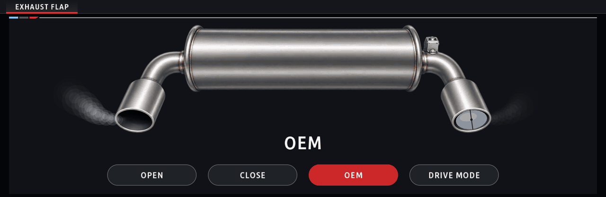
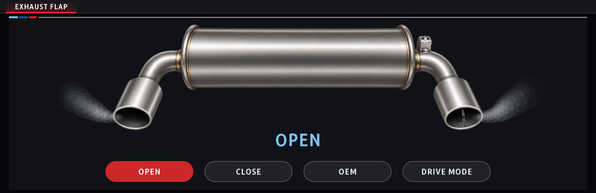
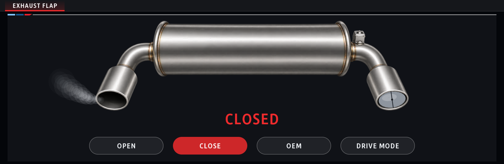
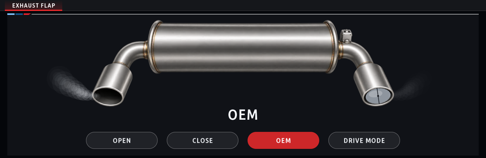
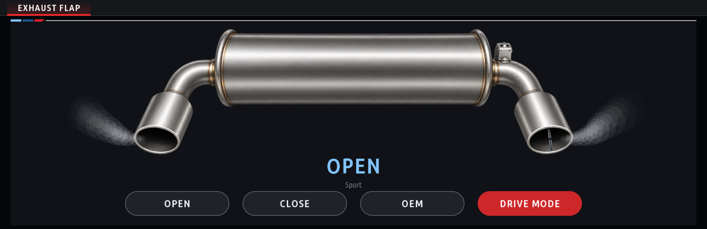

# Exhaust Remote

The exhaust flap on its own: Open, Close or OEM (the car's own strategy) over the head unit's diagnostic link
(InternalTasu, DME `0x12`), shown on a picture of the rear silencer. The flap sits in the right tailpipe, as on the
car, and its butterfly turns with the flap's state; smoke comes out of the left tailpipe always and out of the right
one as far as its flap is open.

| Open | Closed |
|---|---|
|  |  |
| **OEM** | **Drive mode** (Sport) |
|  |  |

## The flap

The same flap control as [Engine Config](../live_adjustments/README.md)'s Exhaust Flap tab: BMW's own `0x2F` job on
DID `0x60FD` (Bosch MG1 / DME8): `2F 60FD 03 03E8` open, `2F 60FD 03 2328` close, `2F 60FD 00` hands the flap back to
the DME. `controller.js`, `adapters.js`, `real_adapters.js` and `diaglink.js` are Engine Config's files, unchanged
(the test checks they stay identical). Each command takes only its own reply.

The *Exhaust Flap* setting is the arm switch and ships **Disarmed** (simulated, nothing is sent; the screen says
SIM). Opening the app only reads; a command leaves only on a button press, or from Drive mode once it is chosen.

## Buttons

| Button | What it does |
|---|---|
| Open | the flap open |
| Close | the flap closed (the rpm guard below) |
| OEM | the flap handed back to the DME |
| Drive mode | the flap follows the driving mode on every change: Sport / Sport+ / Sport Individual → Open; Comfort / Comfort+ / Comfort Individual / Adaptive → OEM; Eco Pro / Eco Pro+ / Eco Pro Individual → Close. The line under the state word names the driving mode. Open, Close or OEM stop following it. |

The choice is saved with the settings (key `driveLink`, not shown in the menu), so Drive mode is still on after the
next start; the driving mode is watched (FES) also while the app is not on screen.

## Settings

| Setting | Default | |
|---|---|---|
| Exhaust Flap | Disarmed | Disarmed (simulated) / Armed (actuates the real valve) |
| Hold Open / Close | On | the DME hands the flap back after ~20 s: On sends Open / Close again every 15 s; Off lets the car take over |
| Close: hand back above | 4,000 rpm | 2,500 – 5,500 rpm or Never: Close is paused (OEM sent, the DME opens the flap as it needs) while the live engine speed is above it, and resumed 500 rpm below it. Open and OEM are never paused |
| Colour theme, Renderer, Demo data | | as in the other apps |
| Made by | | the author's channel |

**No engine speed** (armed, a Close limit set, no live engine speed for 5 s): a manual Close becomes OEM and stays
OEM until Close is pressed again; Drive mode's Eco Pro becomes OEM and Close comes back by itself once a live engine
speed below the limit is back. Demo data never counts as an engine speed.

## Picture and renderers

`muffler_img.js` keeps the picture as ~16k cells on the device pixel grid, fitted to the image: flat ones and shaded
ones (two triangles with a colour at each corner, which the GPU blends). It is drawn once into a cached layer, so
opening the screen costs a few ms and a 0.67 MB upload to the renderer. The software renderer draws triangles in one
colour, so it gets the picture as real pixels instead, made the first time it is used (~50 ms).

## Languages

Menus: the shared catalogues (`kit/runtime/locales/*.tsv`). The line under the state word (driving mode names, the
rpm guard's messages, "holding") and the four buttons: `l10n.js`, since those words are also other apps' text, and
a button upper-cases its label, which would turn Open into the state word OPEN. Every character in `l10n.js` is in
its language's glyph atlas.

## Tests

`node kit/tools/test_exhaust_remote.js` (no SDK, build or car): Drive mode, hold, the rpm guard and the no-rpm
fail-safe (`auto.js`) against a fake controller; the controller against a fake DME through the real diagnostic link
(Disarmed sends nothing, the exact bytes, refusals, OEM queued behind a command in flight); the picture on the GPU
and software paths; the translations and their glyphs; the shared flap files identical to Engine Config's.

Tested on the author's car (G20 320i).
